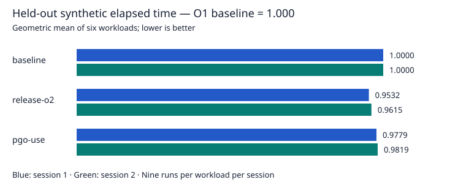

# Optional PGO measurements — 2026-11-05

## Decision

Keep PGO optional. The ordinary O1 default remains unchanged.
This QA-trained profile reduces aggregate elapsed time versus O1, but increases it versus plain O2.
The FFI workload regresses in both sessions. This corpus does not justify enabling PGO by default.
Use representative application training before making a performance decision for that application.

## Method and verification

- Training: core QA and embedding fixtures, with a fresh forced O2 instrumented build.
- Merge: 32 raw profile files; installed Apple `llvm-profdata`.
- Evaluation: the six item 12 workloads; none enters the training command.
- Candidates: O1 baseline, plain O2, and O2 with profile use; all retain debug symbols.
- One warmup and nine measured runs per candidate/workload pair in each session.
- Scale ten; shuffled round seeds 20261113 and 20261114.
- No builds run during timing. Elapsed time includes startup and result checks.
- Hardware: Apple M5; RAM: 34359738368 bytes.
- System: ProductName:		macOS; ProductVersion:		27.0.1; BuildVersion:		26A434.
- Compiler: Apple clang version 21.0.0 (clang-2100.3.34.2).
- Recorded base commit: `6853d69f02e6d16257bcfd8c4eab79f8223846f7`; item 13 build files were uncommitted during measurement.
- Interpreter sources are unchanged in item 13. The profile manifest records the exact source and build-file hashes.
- Generation, profile use, baseline, and plain O2 pass core and embedding checks.
- Profile rejection tests cover missing files, changed source/settings, checksum changes, and incompatible data.
- A valid replacement profile selects a new object directory. Baseline works with a nonexistent profile path.
- One repeat QA run failed localhost UDP tests; the full rerun passes without test changes. Its cause is not established.

See [the PGO procedure](../../doc/apple-silicon-pgo.md) for commands and limitations.
See [the profile manifest](2026-11-05-pgo-profile.json) for training and build identity.
Raw profile binaries remain local generated artifacts. Raw timing samples are linked below.

## Aggregate elapsed time

Geometric means give equal weight to the six workload ratios. Lower is better.

| Candidate | Reference | Session 1 ratio | Session 2 ratio |
| --- | --- | ---: | ---: |
| baseline | baseline | 1.0000 | 1.0000 |
| baseline | release-o2 | 1.0491 | 1.0400 |
| release-o2 | baseline | 0.9532 | 0.9615 |
| release-o2 | release-o2 | 1.0000 | 1.0000 |
| pgo-use | baseline | 0.9779 | 0.9819 |
| pgo-use | release-o2 | 1.0259 | 1.0212 |

PGO takes 2.59% and 2.12% more aggregate elapsed time than plain O2.
FFI takes 18.20% and 16.71% more elapsed time than plain O2.
The O1-relative aggregate reductions are 2.21% and 1.81%, below the item 12 default-change threshold.

## Session 1

MAD is median absolute deviation, not a confidence interval. RSS uses MiB (1,048,576 bytes).

| Mode | Workload | Median seconds | MAD seconds | Min–max seconds | Median peak RSS, MiB |
| --- | --- | ---: | ---: | ---: | ---: |
| baseline | evaluation | 0.5427 | 0.0033 | 0.5351–0.5465 | 2.33 |
| baseline | allocation | 0.3462 | 0.0013 | 0.3424–0.4847 | 2.34 |
| baseline | lists | 0.4425 | 0.0027 | 0.4398–0.4498 | 2.95 |
| baseline | symbols | 0.2334 | 0.0015 | 0.2298–0.2359 | 2.62 |
| baseline | numeric | 0.5412 | 0.0053 | 0.5335–0.5504 | 2.31 |
| baseline | ffi | 0.4002 | 0.0133 | 0.3798–0.4669 | 2.34 |
| release-o2 | evaluation | 0.5268 | 0.0045 | 0.5167–0.5369 | 2.34 |
| release-o2 | allocation | 0.3224 | 0.0008 | 0.3209–0.3258 | 2.38 |
| release-o2 | lists | 0.4198 | 0.0012 | 0.4168–0.4234 | 2.97 |
| release-o2 | symbols | 0.2266 | 0.0005 | 0.2248–0.2290 | 2.67 |
| release-o2 | numeric | 0.5166 | 0.0016 | 0.5139–0.5257 | 2.33 |
| release-o2 | ffi | 0.3778 | 0.0074 | 0.3704–0.4301 | 2.36 |
| pgo-use | evaluation | 0.5117 | 0.0010 | 0.5098–0.5312 | 2.34 |
| pgo-use | allocation | 0.3239 | 0.0016 | 0.3215–0.3883 | 2.36 |
| pgo-use | lists | 0.4337 | 0.0012 | 0.4134–0.4567 | 2.97 |
| pgo-use | symbols | 0.2205 | 0.0009 | 0.2184–0.2219 | 2.66 |
| pgo-use | numeric | 0.5195 | 0.0021 | 0.5165–0.5238 | 2.33 |
| pgo-use | ffi | 0.4466 | 0.0072 | 0.4337–0.4638 | 2.34 |

[Raw session 1](2026-11-05-pgo-session-1.json).

## Session 2

MAD is median absolute deviation, not a confidence interval. RSS uses MiB (1,048,576 bytes).

| Mode | Workload | Median seconds | MAD seconds | Min–max seconds | Median peak RSS, MiB |
| --- | --- | ---: | ---: | ---: | ---: |
| baseline | evaluation | 0.5403 | 0.0037 | 0.5363–0.5571 | 2.33 |
| baseline | allocation | 0.3422 | 0.0013 | 0.3393–0.3446 | 2.34 |
| baseline | lists | 0.4443 | 0.0021 | 0.4397–0.4661 | 2.95 |
| baseline | symbols | 0.2312 | 0.0008 | 0.2292–0.2346 | 2.62 |
| baseline | numeric | 0.5413 | 0.0049 | 0.5336–0.5527 | 2.31 |
| baseline | ffi | 0.4039 | 0.0135 | 0.3808–0.4293 | 2.34 |
| release-o2 | evaluation | 0.5293 | 0.0012 | 0.5230–0.5335 | 2.34 |
| release-o2 | allocation | 0.3230 | 0.0015 | 0.3207–0.3305 | 2.38 |
| release-o2 | lists | 0.4208 | 0.0023 | 0.4171–0.4248 | 2.97 |
| release-o2 | symbols | 0.2262 | 0.0007 | 0.2228–0.2283 | 2.66 |
| release-o2 | numeric | 0.5200 | 0.0029 | 0.5116–0.5249 | 2.33 |
| release-o2 | ffi | 0.3879 | 0.0148 | 0.3731–0.4509 | 2.36 |
| pgo-use | evaluation | 0.5126 | 0.0020 | 0.5085–0.5150 | 2.34 |
| pgo-use | allocation | 0.3219 | 0.0019 | 0.3182–0.3269 | 2.34 |
| pgo-use | lists | 0.4336 | 0.0067 | 0.4123–0.4403 | 2.97 |
| pgo-use | symbols | 0.2210 | 0.0011 | 0.2190–0.2228 | 2.67 |
| pgo-use | numeric | 0.5201 | 0.0027 | 0.5147–0.5236 | 2.33 |
| pgo-use | ffi | 0.4527 | 0.0111 | 0.4380–0.4663 | 2.34 |

[Raw session 2](2026-11-05-pgo-session-2.json).

## Limits

The training corpus tests correctness; it does not model a real application.
Evaluation remains synthetic and runs on one machine with one compiler.
Operating-system activity, power state, and temperature are not fully controlled.
These measurements do not establish gains for user applications or other Macs.
No interpreter tuning follows from these results without the separate item 14 profiling step.
