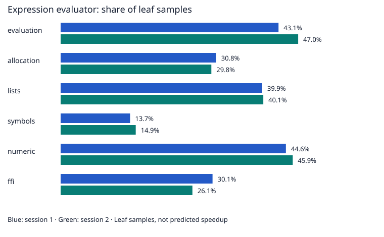

# Native interpreter profiles — 2026-11-05

## Outcome

Item 14 completes with a profiling report. No interpreter optimization is claimed.
Repeated profiles identify evaluation, cell copying/deletion, and symbol lookup as investigation targets.
A large sampled cost does not establish a safe change or predict its speedup.

## Method

The installed macOS `sample` tool collects two three-second profiles per workload at a requested one-millisecond interval.
`xctrace` is unavailable; no software is installed.
The binary is the ordinary O1 build from item 13, with debug symbols.
All six workloads run at scale 200 and finish with checked results. All 12 runs pass.
Binary identity and workload hashes are recorded in [summary.json](profiles-2026-11-05/summary.json).
Compressed native reports preserve call trees, source lines, system details, and image identities.
The summary uses collapsed leaf counts, not recursive inclusive totals. Counts below five are unlisted.
Sampling adds overhead. These observations are not timing comparisons or demonstrated speedups.

```sh
python3 benchmarks/profile.py --binary "$(make -s -f makefile_darwin_arm64 print-binary MODE=baseline)" --output build/profiles/new-session
```

## Observations



| Workload | Session | Samples | Top three leaf functions (share of samples) |
| --- | ---: | ---: | --- |
| evaluation | 1 | 2472 | evaluateExpression (newlisp): 43.1%; deleteList (newlisp): 14.6%; evaluateLambda (newlisp): 11.7% |
| allocation | 1 | 2489 | evaluateExpression (newlisp): 30.8%; deleteList (newlisp): 20.3%; copyCell (newlisp): 14.3% |
| lists | 1 | 2494 | evaluateExpression (newlisp): 39.9%; copyCell (newlisp): 18.4%; deleteList (newlisp): 18.4% |
| symbols | 1 | 2205 | findInsertSymbol (newlisp): 36.9%; evaluateExpression (newlisp): 13.7%; _xzm_xzone_malloc_tiny (libsystem_malloc.dylib): 9.8% |
| numeric | 1 | 2492 | evaluateExpression (newlisp): 44.6%; deleteList (newlisp): 15.5%; arithmetikOp (newlisp): 11.5% |
| ffi | 1 | 2315 | evaluateExpression (newlisp): 30.1%; executeLibFFI (newlisp): 10.4%; ffi_call_int (libffi.dylib): 10.2% |
| evaluation | 2 | 2474 | evaluateExpression (newlisp): 47.0%; deleteList (newlisp): 13.2%; evaluateLambda (newlisp): 10.1% |
| allocation | 2 | 2501 | evaluateExpression (newlisp): 29.8%; deleteList (newlisp): 20.4%; copyCell (newlisp): 13.5% |
| lists | 2 | 2498 | evaluateExpression (newlisp): 40.1%; copyCell (newlisp): 19.5%; deleteList (newlisp): 17.2% |
| symbols | 2 | 2247 | findInsertSymbol (newlisp): 37.9%; evaluateExpression (newlisp): 14.9%; _xzm_xzone_malloc_tiny (libsystem_malloc.dylib): 8.8% |
| numeric | 2 | 2512 | evaluateExpression (newlisp): 45.9%; deleteList (newlisp): 14.9%; getInteger64Ext (newlisp): 10.1% |
| ffi | 2 | 2266 | evaluateExpression (newlisp): 26.1%; ffi_call_int (libffi.dylib): 23.5%; deleteList (newlisp): 10.5% |

## Source review and next experiments

- `newlisp.c:evaluateExpression` handles dispatch, evaluation state, tracing, recursion, and result-stack cleanup. A general fast path must preserve all these effects.
- `newlisp.c:copyCell` already transfers ownership from the result stack when possible. Avoiding copies requires explicit ownership and lifetime tests.
- `newlisp.c:deleteList` handles nested values, allocated payloads, and protected singleton cells. Replacing it with a generic free-list shortcut is not justified.
- `nl-symbol.c:findInsertSymbol` dominates the symbol workload. It searches a balanced tree with a two-byte prefix comparison. Before adding a cache, test hit rates and define invalidation for deletion and context changes.
- `nl-import.c:executeLibFFI` and native libffi appear in the FFI profiles. Leaf shares vary between sessions. These O1 profiles do not establish the cause of the earlier PGO regression.

The next useful experiment is a lookup-focused study with different symbol counts, name prefixes, and context mutation rates.
Check generated machine code before changing prefix comparisons; the compiler can already remove redundant loads.
Propose a concrete change after that study. Require normal and sanitizer QA plus two independent timing sessions before accepting it.
A real application corpus would help decide which of these costs matters to users.

## Verification and limits

All 12 workload checks pass. Reparsed compressed reports match every saved sample count and leaf summary.
The binary SHA-256 matches the recorded identity. No interpreter source or build flags change in this item.
Core and sanitizer suites are not rerun for this report-only change; their earlier results remain historical verification.
Sampling covers one machine and synthetic workloads. No ARM assembly, evaluator rewrite, or symbol cache is introduced.
